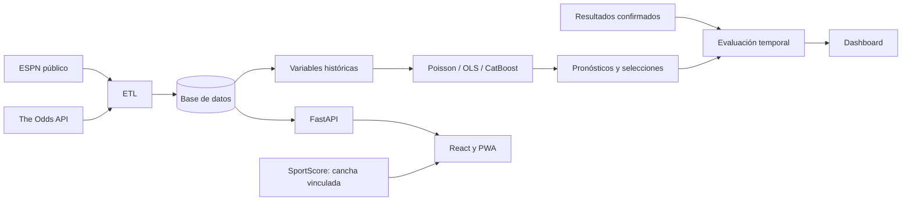
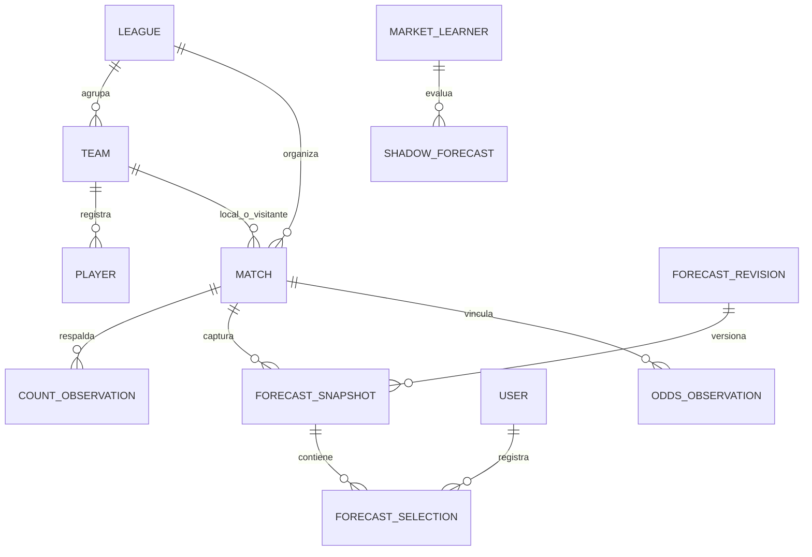

# Diagramas del sistema

## Arquitectura

## Relaciones principales

Resumen conceptual; las columnas y relaciones exactas están en `backend/app/infrastructure/db/models.py`.

No se intercambian IDs entre proveedores. Una selección no cambia el resultado real. Se conservan versiones para auditoría.
